<p align="center">
  <a href="https://medinstech.com"></a>
</p>

<p align="center">
  一个桌面应用：画出电路，把它布到洞洞板上——或者条板上，或者先放到免焊面包板上——<br>
  让布线器算出连接，验证板子与原理图一致，并得到一份带测量检查点的<br>
  分步搭建指南。
</p>

<p align="center">
  <a href="https://github.com/medinstech/perfboard-studio/actions/workflows/ci.yml"></a>
  <a href="https://github.com/medinstech/perfboard-studio/releases/latest"></a>
  <a href="https://github.com/medinstech/perfboard-studio/blob/main/pyproject.toml"></a>
  <a href="https://github.com/medinstech/perfboard-studio/blob/main/LICENSE"></a>
</p>

<p align="center">
  <b>1.</b> <a href="https://github.com/medinstech/perfboard-studio/releases/latest"><b>下载</b></a> Windows、macOS 或 Linux 安装包——或者 <a href="#从-pypi-安装"><code>uv tool install perfboard-studio</code></a><br>
  <b>2.</b> 在首页画出第一个电路、打开一个示例，或者走一遍一分钟导览<br>
  <b>3.</b> 一直按右上角的蓝色按钮，直到搭建指南打开——它总会告诉你下一步是什么
</p>

<p align="center">
  <a href="https://github.com/medinstech/perfboard-studio/blob/main/docs/MCP.md">MCP 服务器</a>
  &nbsp;·&nbsp; <a href="#或者打开一块已经做好的板">示例板</a>
  &nbsp;·&nbsp; <a href="https://github.com/medinstech/perfboard-studio/blob/main/CHANGELOG.md">更新日志</a>
  &nbsp;·&nbsp; <a href="https://github.com/medinstech/perfboard-studio/blob/main/README.md">English</a>
  &nbsp;·&nbsp; <a href="https://github.com/medinstech/perfboard-studio/blob/main/README.tr.md">Türkçe</a>
</p>

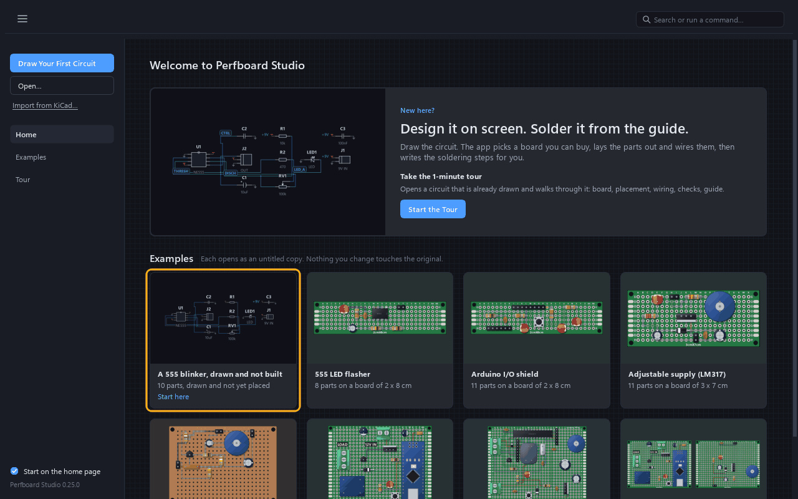

<p align="center">
  555 闪烁器示例，已经画好但还没搭建；右上角的按钮把它带到搭建指南：<br>
  从试过的所有成品板尺寸中选一块，放好元件，接好线并检查。
</p>

第一次来？[从首页到搭建指南，做你的第一块板](https://github.com/medinstech/perfboard-studio/blob/main/docs/FIRST_BOARD.md)
用大约十分钟，带 555 闪烁器走完上面每一步。

Perfboard Studio 是为手工焊接的板子做的，因此有三件事随之而来。焊锡走线和导线是
不同的连接，有不同的代价和限制，布线器会在两者之间选择。搭建指南是一串带检查点的
步骤，按你实际焊接的顺序排列。板子还要和电路对照检查：提取真正连在一起的东西——
对洞洞板来说，就是你铺下的铜。

---

- **带验证步骤的焊接指南。** 不只是“在这里焊 R1”，而是
  *“第 2 块完成 → U1 第 4 脚到 C3(−) 必须导通”* 和 *“上电前：GND 到 V+ 的读数应大于
  10 kΩ”*。它从网表推导，所以是精确的，而不是泛泛的建议。
- **先检查电路，再检查板子。** 电路还在画的时候，ERC 就能抓出电源脚没接的芯片、
  电解电容或 LED 画反、只连到一个引脚的网络，以及没有任何连接器或电池把电源带上板的
  情况。电路到了板上以后，洞洞板 LVS 会提取板子的真实连通性并与原理图比较：开路、
  短路和悬空导体都会在你拿起烙铁之前报告出来。
- **六种连接，不是一种。** 弯引脚、焊锡走线、加线焊锡走线、裸线、绝缘线和跨过元件的
  跳线，代价、限制和失效方式都不同，布线器会为六种都计价——这才让布局在真正焊接时
  顺手。
- **先面包板，再洞洞板。** 免焊面包板也是一种板型：放置、用跳线接线、把电源接到电源轨，
  并给出一份不用烙铁的搭建指南。电路跑通后，同一份设计可以转到洞洞板——或者转到
  可焊接面包板，孔位一一对应。
- **只有第三个维度才能看到的四条规则。** 元件高过外壳、跳线被压在随后焊上去的元件
  本体下面、热敏元件离发热元件太近、元件藏在模块抬高的板子下面——从上面看只是重叠，
  装得上，但模块一装上就够不着了。3D 视图是检查工具，不是效果图——板子还会以同样
  本体的 STEP 模型导出，用来给外壳开孔。
- **有名字的真实元件。** 从目录里挑一个 BC547、7805 或 Arduino Nano，它会带着数据手册
  给每根引脚的命名一起到来。如果你有 KiCad 网表，也可以同样导入——当符号的引脚编号
  和你手里元件的编号不同时，会按名字重新编号，所以板子是按你真正要焊的元件接的。
- **为 agent 而生。** 一个 MCP 服务器、一个无界面 CLI，以及可用 Git 比较差异的工程
  文件，全部走和 GUI 相同的命令总线——所以人和模型轮流编辑同一块板时，撤销仍然有效。

> **状态：pre-alpha，但已经端到端可用。** 电路进去，焊接指南出来。缺的是
> dogfood 测试——还没有人照着生成的指南真正焊出一块板，项目计划说在有人做到之前
> M5 不算完成。其他部分都能跑，每个版本都为三个桌面平台提供安装包，Windows 安装包
> 从 0.26.0 起带代码签名。

**跳转** — [运行它](#运行它) ·
[连接](#连接并不只有一种) ·
[两面与第三个维度](#两面与第三个维度) ·
[真实元件](#有名字的真实元件) ·
[原理图](#先画电路) ·
[指南](#搭建指南有顺序也能回放) ·
[从 agent 开始](#从-agent-开始) · [代码结构](#代码是怎么组织的) ·
[文档](#其他文档都在哪里) ·
[参与贡献](#参与贡献)

## 连接并不只有一种

大多数工具把洞洞板上的连接建模成“一根线”。洞洞板有六种物理上不同的方式把两个点
连起来，每种都有自己的代价、限制和失效方式——正是对这种差异建模，才让布线器产出的
布局在真正焊接时顺手：

| | 是什么 | 说明 |
|---|---|---|
| 弯引脚 | 把元件引脚弯到旁边的孔里 | 基本免费，3–4 个孔 |
| **焊锡走线** | 只用焊锡把相邻焊盘连起来 | 只能横平竖直；到下一个焊盘约 0.6 mm |
| **加线焊锡走线** | 同上，但在镀锡导线外面再铺焊锡 | 电阻约低 10 倍，长度不限 |
| 裸线 | 焊接面的镀锡导线 | 不能跨过另一根裸导体 |
| 绝缘线 | 可以自由交叉 | 代价是准备时间 |
| 跨过元件的跳线 | 元件面的绝缘跳线 | 看得见，占用本体空间 |

到相邻焊盘只有 0.6 mm，这就是焊锡走线既好用又容易出错的原因。Perfboard Studio 把
这个风险计入布线器的代价函数，并把每个被标记的位置变成搭建指南里的一个测量步骤。

**或者完全不用焊。** 免焊面包板也是一种板型，有市售的三种尺寸，孔位按它印的方式
命名——`e12`，先写行字母。放置器会让同一夹里的两个网络分开，把每个芯片跨在凹槽上；
布线器把跳线送进空孔，把地线和电源接到电源轨；指南则变成搭建指南：先插跳线，平贴在
塑料上，全程不用烙铁。电路跑通后，*File ▸ New Board from This Design…* 把它带到
洞洞板，而面包板的文件保持原样。或者 *File ▸ Same Layout on a Solderable Breadboard…*
把它放到可焊接面包板上——同样的孔和铜条——每个元件和跳线都在原来的孔位，随附的指南
又变回焊接指南。

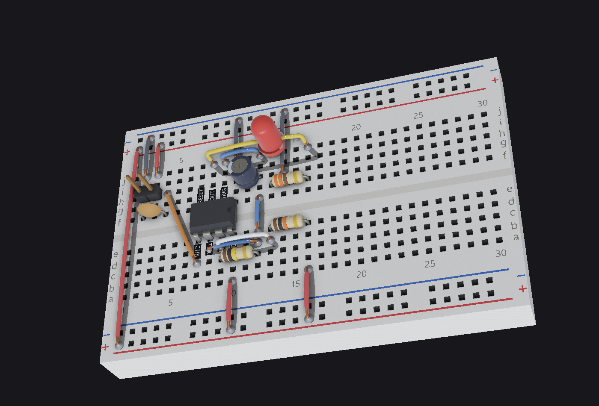

## 两面与第三个维度

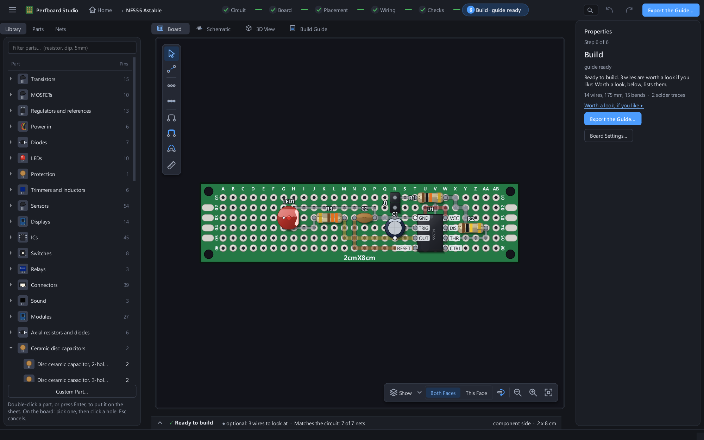

<p align="center">
  状态栏就是全部结论：没有问题，板子在全部七个网络上与电路一致——<br>
  还有一处要在工作台上检查：一个用于验证隔离的焊盘，搭建指南会把它变成用万用表做的检查。
</p>

焊接面才是铜所在的一面，所以它是一等视图，而不是镜像模式——你*没有*看的那一面的铜
用斜线表示，因为板子不透明，画成实线的走线表示*它就在你眼前*。

**而且两面都可以铺铜。** 在两面都有焊盘的板上，你画的东西落在你正在看的一面；一个
网络也可以有自己的面——在属性里选 **Either**、**Component Side** 或 **Solder Side**——
自动布线会尽可能让它留在这个面上。走线通过自己网络的一个引脚换面，或者通过一个空孔：
指南会让你把它填上再测量；如果某个引脚在那一面被已装好的元件盖住，就用一根线接到
它旁边的空孔，再从下面用一小段剪下的引脚把空孔和引脚连起来。如果某个网络无法留在
自己的面上，自动布线会说明哪些连接离开了它以及为什么。

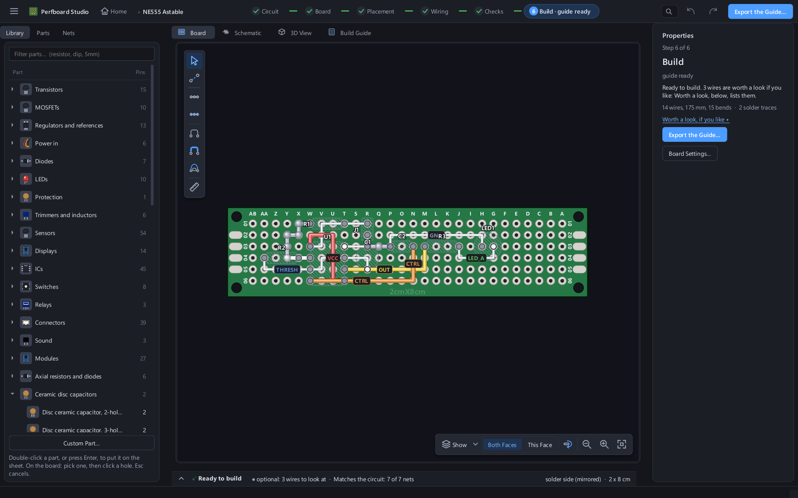

3D 视图是检查工具，不是效果图。有四条规则是俯视图完全看不到的：元件高过外壳、跳线
被压在随后焊上去的元件本体下面、热敏元件离发热元件太近，以及元件藏在模块抬高的
板子下面——从上面看只是重叠，装得上，但模块一装上就够不着了。

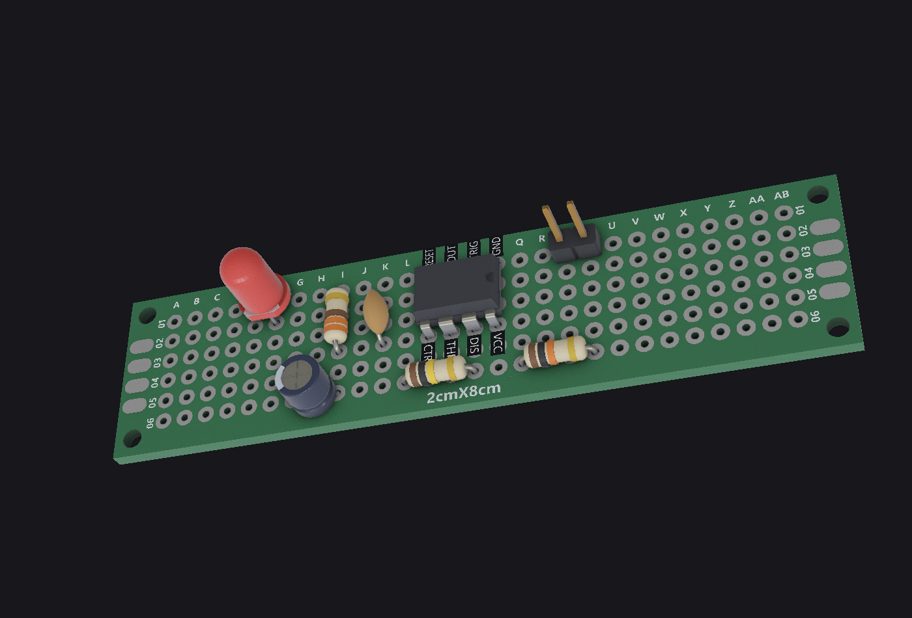

**它站在板子旁边，也会回应点击。** 板子、原理图、3D 和搭建指南是同一个画布上的
标签页，拖到一边的标签会站在其他标签旁边。在 3D 里点一个元件，它会在板上和图上同时
被选中，搭建指南跳到对应步骤；点一根线，它的网络会在所有地方亮起；任何地方选中的
东西都会在 3D 里着色，所以三个视图显示的是同一个选择。

**而且它会以 STEP 导出。** *File ▸ Export ▸ 3D Model (STEP)…* 把板子写成机械 CAD
程序可以测量、可以围绕它切外壳的实体：带所有孔和安装孔的板子，每个元件占据的空间——
正是 DRC 的 overhang 和 too-tall 规则测量的轮廓与高度——每根引脚穿过它的孔，每根线
都按切割清单印出的线规那么粗，跨过什么就抬到什么上面。应用自己写这个文件，所以不需要
图形驱动，也不需要额外依赖；保存工程时会在其他输出旁边放一份。

## 有名字的真实元件

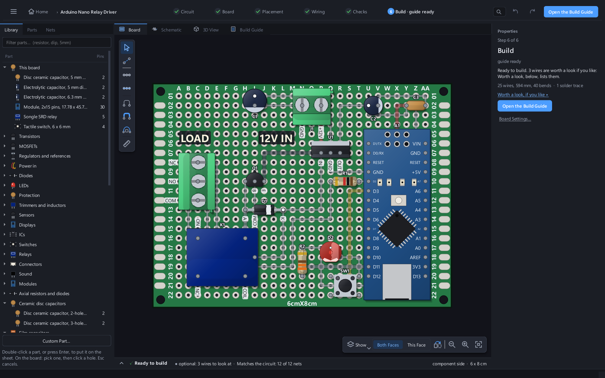

封装不是元件。TO-92 可以是 BC547、2N7000 或 78L05，哪条腿是基极才是板子依赖的事实。
元件库从一份**目录**开始，里面是洞洞板真正会用的元件——晶体管和 MOSFET、稳压器和
各种供电方式、二极管、传感器和显示器、IC、开关、继电器、蜂鸣器和开发板——挑一个，
它会带着数值、数据手册给每根引脚的名字、以及它画成的符号一起放置，每个都附来源
数据手册。板上已有的元件可以通过属性里封装旁边的 **Change…** 变成另一个：同样的
位置、同样的位号、同样的网络，一步撤销。

**这些名字会印在引脚旁边**，在板上和 3D 里都是，因为端子或开发板就是按它们接线的。
它们会为整块板统一排布：名字遇到挡路的东西就停下；一行里的元件会把名字印在空着的
一侧；空间不够的名字会变窄；完全没地方的名字会省略，并列在元件的提示信息里。开发板
是一个**模块**——它自己的板子站在排针上——在两个视图里都画成它实际有的东西，尺寸来自
厂商图纸和 KiCad 模型：Nano 的芯片转了个角、USB 口和复位按钮；ESP32 开发板的无线
模块屏蔽罩和天线；绿色的 Pico。朝向从图上一眼就能看出来。而且**板子可以写字**：在
端子旁边写一个“12V IN”这样的标签，它会落在任意一面，并印在 1:1 图纸和指南里。

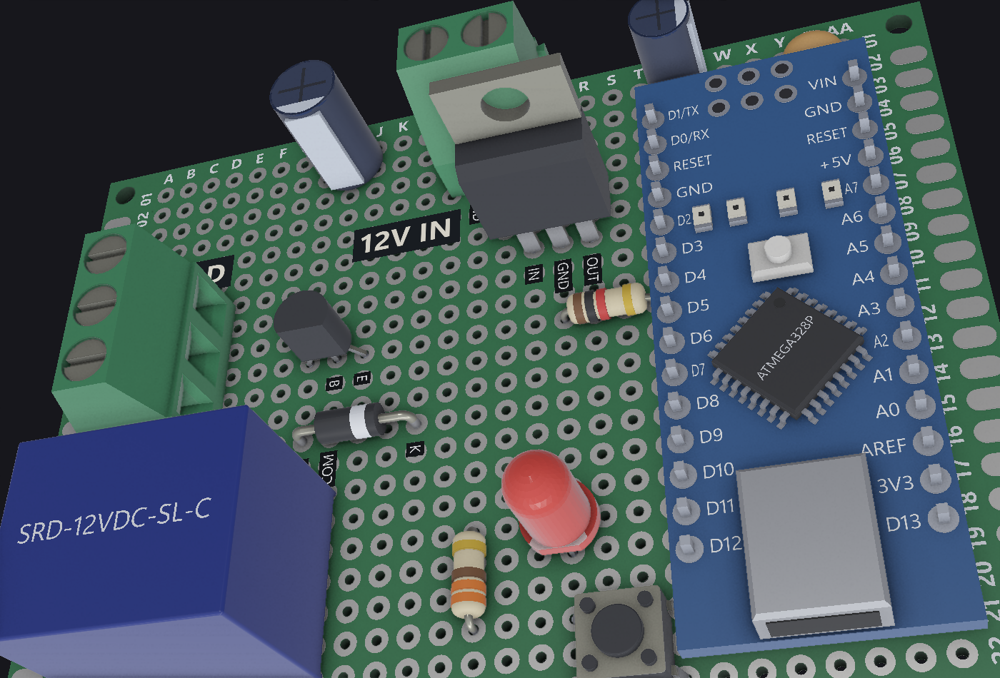

**KiCad 网表是按元件导入的，不是猜的。** 上面这块板就是
[`examples/nano-relay.net`](https://github.com/medinstech/perfboard-studio/blob/main/examples/nano-relay.net) 原样导入的。它的数值
命名了目录里的元件——Nano、BC547、1N4007、7805——其余的由 KiCad 封装名测量出来，
从 `R_Axial_DIN0207_L6.3mm_D2.5mm_P7.62mm` 到 `SW_PUSH_6mm`。当原理图符号的引脚
编号和元件不同时，会按名字重新编号：KiCad 的 Nano 一边向下编号、另一边向上，LED
阴极在前；而一个写着“BC547”的通用晶体管符号是发射极在前——任何一个按编号直接接，
都会把板子接到一个不存在的元件上。

**面板上的元件是接线，不是放置。** 电位器、插孔或脚踏开关装在机壳面板上，从右键
菜单把它放到面板：在板上它变成导线落入的那一排焊盘，位置就是它引脚所在的地方，
所以铜仍然能接到它们；在图上和元件清单里，它仍然是电位器。指南会用长导线把它接进去，
说明哪个焊盘接到哪个端子、导线从哪条边出去，把每根线按它网络的颜色画进切割清单，
并且只在它的线接好后才检查它的网络。

## 先画电路

板子决定东西放在哪里。原理图面板（`Ctrl+2`）——它旁边的标签页——说明*你在造什么*，
也是你表达它的地方：**Add Part…**、把两个引脚 **Connect**、**Place on the Board**。
电路在前，布局在后，这是其他所有 EDA 工具的工作方式，也是这个工具直到现在才做到的
顺序。

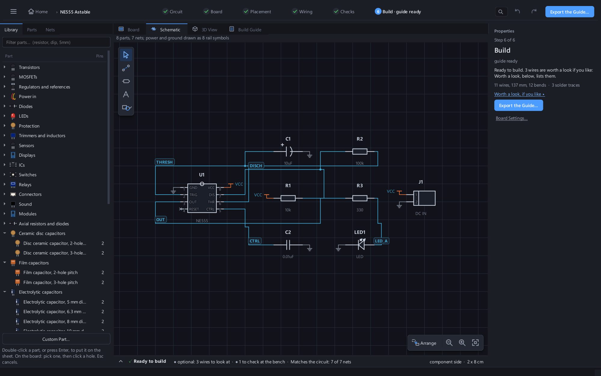

**在你接手之前，图是为你排好的。** 只要图上还没有东西被移动，它就是按网表画的，
没有什么需要保持同步；移动一个符号、旋转一个、或者画一根线，从那一刻起图就是你的了——
直到 **Arrange** 把它交还给布局，所有连接保持不变，一步撤销。导线从引脚到引脚，
或者接到已经画好的线上——一个 **T**，落点有一个圆点——在你点击的地方转弯。画好后
可以拖成新形状，或者把端点拖到另一个引脚；Delete 会剪断它并说明哪些引脚离开了网络。
太忙画不下的网络用标签在引脚或线上按名字连接。地和电源变成电源轨符号而不是导线，
这就是一张能读的图和十一条线横穿一切的区别。极性来自元件库自己的引脚名，所以 LED
的阴极和二极管的阴极都会落在带横杠的一端——它们是相反的引脚，靠“第 1 脚”猜的规则
会把其中一个画反。元件库没有记录引脚定义的元件，比如 TO-92，就是一个带标签的方框：
在那里画晶体管等于断言哪条腿是基极。

它也会交叉探测：点一个符号，那个元件在板上被选中；点一根线，它的网络在两个地方
同时亮起。LVS 说 *net VOUT is open* 时，如果你能看着 VOUT，这句话有用得多。

**而且它会离开窗口。** *File ▸ Export ▸ Schematic…* 把图以三种方式写在文档旁边：
SVG 用来嵌入或编辑，PDF 用来打印并放在板子旁边，PNG 用来粘贴到“这电路为什么不工作”
的消息里。三种都来自同一份 SVG，所以它们不会对电路是什么产生分歧——导出的图是白底
黑字，而不是面板的深底亮字，因为电源轨符号已经说明哪条轨灌电流、哪条供电流，而复印机
保留形状，不保留颜色。

## 搭建指南有顺序也能回放

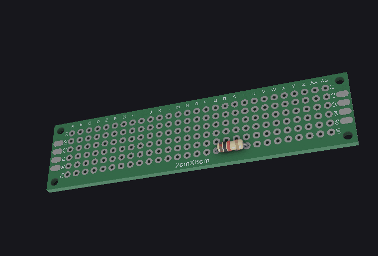

元件**从最矮的开始**装——高元件早装会让板子没法平放在工作台上焊矮元件。然后翻过
板子铺铜，IC 最后装，因为热和 ESD。会被压在元件本体下面的跳线会提前到*第一*阶段，
因为等那个元件装上去就晚了。

动画在中途把板子翻过来，理由和你一样：洞洞板不透明，这次搭建的二十二步里有十四步
发生在从上面看不到的那一面。它是用 3D 面板组装滑块调用的同一个函数回放指南生成的，
所以不会显示指南实际没有给出的顺序。

每个接线步骤都会把线画两遍：一遍按板孔弯成形状，一遍拉直，每个标记都从一端量起。
指南最后会把所有线按真实尺寸放在一把 50 mm 尺子旁边——按 100% 打印，把每根线剪到
它的图，做标记，弯好。端到端的图长正好是切割清单给出的长度，因为两者来自同一组数字。

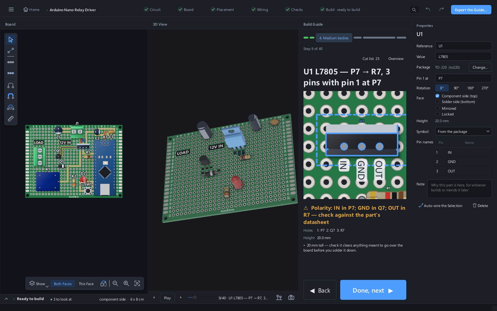

**而且在工作台上它会记住你做到哪。** 搭建指南面板（`Ctrl+4`）一次显示一步，大到
隔着工作台也能读：该步骤时的板子，放大到这一步的孔并标出元件——如果这一步在焊接面
完成，就从焊接面看——然后是指南的文字、元件朝向、它的孔，以及这一阶段的检查项。
**Done, next** 打勾并前进，**Back** 后退。勾选状态跟着那块板——保存在应用设置里而不是
文件里，所以打勾不是编辑，也不进入撤销——整个搭建在 **Overview** 里一键可达，
**Next Step to Do** 会找到第一个没打勾的步骤。这一步也会在板上和 3D 里标出，3D 视图
显示搭建到那一刻的板子；它 **Play** 两边的箭头一次走一步，这正是手里拿着烙铁的人
想要的移动方式。

## 多块板与一根线缆

一个工程可以不止一块板：比如一个控制器和它的电源，中间用一根线缆连接。**Board ▸
Add Board**（或板上方条带里的 **+ Add Board**）添加第二块板并把它放到前面；条带会
列出每块板，第一项 **System** 把它们并排画出，线缆按导线的颜色连在中间。电路仍然
只画一次，每个元件放在它所属的板上。要连接两块板，**Board ▸ Add Cable…** 要求各选
一个连接器，按网络配对导线，配不上的会说出来而不是猜。同样的检查在整个系统上运行，
所以板与板之间断开的网络、或者接反的线缆，都会以线缆的名字报告。每块板的搭建指南
都以线缆结尾：剪什么、每端接到哪里、量什么。

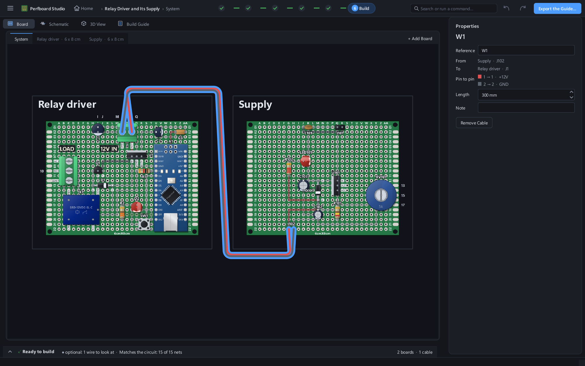

完整走查在[你的第一块板](https://github.com/medinstech/perfboard-studio/blob/main/docs/FIRST_BOARD.md#several-boards-and-a-cable)，
`examples/relay-and-supply.perf` 是一个做好了的系统，可以直接打开。

## 运行它

它是桌面应用，所以最普通的获取方式是安装一个。不需要 Python。

**[⬇ 下载最新版本](https://github.com/medinstech/perfboard-studio/releases/latest)**

| | |
|---|---|
| **Windows** | 一个 `.exe` 安装包 |
| **macOS** | 一个 `.dmg`，Apple silicon |
| **Linux** | 一个 `.AppImage`，x86_64 |

每个都由产生它的 tag 构建并做冒烟测试。**从 0.26.0 起，Windows 安装包由 Medinstech
代码签名**，更新也只从签名的安装包安装。macOS 和 Linux 包还没有签名，所以首次运行会
警告，发布说明里写了怎么绕过。见 [docs/RELEASING.md](https://github.com/medinstech/perfboard-studio/blob/main/docs/RELEASING.md)。

界面会说**英语、土耳其语和简体中文**（`--lang tr`、`--lang zh`，或跟随系统区域设置），它写出的搭建指南也是——
步骤、检查、切割清单。

### 从 PyPI 安装

用于两个没有构建包的平台——Intel Mac、ARM 上的 Linux——以及任何不想点过签名警告的人。
需要 **Python 3.12+**：

```sh
uv tool install perfboard-studio    # or: pipx install perfboard-studio

perfboard-studio                    # launch on a blank board
perfboard-studio some/board.perf    # ...or open a document
perfboard-studio --version
```

**用 `uv tool` 或 `pipx`，不要直接 `pip install`**，因为这是应用而不是库。两者都会把它
放进自己的环境，并把 `perfboard-studio` 放到你的 PATH；而 `pip install` 要么把 400 MB 的
Qt 和 VTK 塞进共享的 `site-packages`，要么在 Debian、Ubuntu 和 Fedora 上被系统 Python
直接拒绝（PEP 668）。从克隆开始的话，在虚拟环境里 `pip install -e .`。

Qt 和 VTK 占了那 400 MB 的大部分。没有更小的构建，因为 3D 视图是应用依赖的检查工具，
不是可选附加项。

### 从零开始做一块板

顶部条带会带你走——**Circuit、Board、Placement、Wiring、Checks、Build**——说明每一步
板子处于什么状态，右边的按钮做下一件该做的事。手动操作是这样。

打开原理图（`Ctrl+2`）画电路：从元件库把元件拖到图上，或者按 **Add Part…**，输入
元件是什么再回车，一个接一个；把它们移动、旋转到想要的位置，从引脚到引脚 **Connect**，
或者接到已经画好的线上（点两端以及中间转弯的地方，或者拖；在电源引脚上连接的网络会
采用它的名字，VCC 或 GND）——或者用 **Label** 给引脚起名，按名字接到网络，或者右键
选 GND 和 +5V——然后 **Place on the Board**，它会先问用哪种成品板：你的电路会在一块
宽松的板上、以及每块更小的板上被放置、接线和检查，建议的是它表现同样好的最小板。
接下来 **Board ▸ Rearrange Parts**（`Ctrl+Shift+A`）、**Wiring ▸ Auto-wire Everything**
（`Ctrl+R`）和 **File ▸ Export ▸ Build Guide…**（`Ctrl+B`）。全程没有 KiCad。

或者自己铺铜。板子旁边的工具画成它们铺的东西——焊锡珠、弯线、套管线、跨过元件的
跳线——指上去会说出名字。在一个孔上按下并拖到另一个孔：松开之前，预览会说明铜会
在哪里接到另一个网络。在 **Select** 里，按在铜上会抓起一个端点、一个拐角或整段并移动它。

已经有电路的话，从 `examples/ne555-astable.net` 上的 **File ▸ Import from KiCad…**
（`Ctrl+I`）开始：每个元件按它的数值和 KiCad 封装所说明的样子进入设计，然后顶部条带
的步骤接手——**Choose a Board…**、**Place on the Board**、接线、检查、搭建。上面截图
就是从这个顺序里出来的——见 [`tools/screenshots.py`](https://github.com/medinstech/perfboard-studio/blob/main/tools/screenshots.py)。

### 或者打开一块已经做好的板

[七个示例](https://github.com/medinstech/perfboard-studio/blob/main/examples/README.md)同时提供网表和做好的板：

```sh
perfboard-studio examples/lm317-supply.perf
```

| | 用来说明什么 |
|---|---|
| `ne555-astable` | 起点——一个 555 闪烁 LED |
| `lm317-supply` | 一个 TO-220 稳压器，让热规则有东西可量 |
| `lpb1-booster` | 做在 **FR-2** 上，那种焊盘容易脱落的酚醛板 |
| `arduino-io-shield` | 两排排针，盾板基本上就是这个 |
| `atmega328-relay` | 规模：二十四个元件，所有规则同时出现 |
| `nano-relay` | 来自 KiCad 网表的真实元件——排针上的 Nano、目录里的 BC547 和 7805、引脚上的名字、板上的标签 |
| `relay-and-supply` | 多块板：继电器驱动和它的电源在两块板上，用线缆连接，作为一个系统检查 |

七个示例都能布通、在 LVS 下与原理图一致、没有 DRC 错误——
`tests/test_examples.py` 在每次提交时都会断言这一点。

### 从 agent 开始

MCP 服务器驱动同一套命令总线，所以撤销在两边都有效：

```sh
claude mcp add perfboard-studio -- uvx --from "perfboard-studio[mcp]" perfboard-studio-mcp
```

不需要先安装——`uvx` 会把包取到自己的缓存。从克隆开始的话，是
`pip install -e ".[mcp]"`，然后 `claude mcp add perfboard-studio -- perfboard-studio-mcp`。
从 0.22.0 起，安装好的应用本身就是服务器，完全不需要 Python：Windows 上是
`perfboard-studio-cli.exe --mcp`，各平台的路径在 docs/MCP.md 里。

70 个工具，每个孔都按人们谈论洞洞板的方式寻址（`A1`、`C7`、`AC12`）——或者在面包板上
按它印的方式（`e12`、`T+12`）——从不用裸坐标——一直到 `export_step`，把做好的板子交给
画外壳的 CAD 程序。工具列表、其他客户端需要的 JSON 配置和其余设置见
[docs/MCP.md](https://github.com/medinstech/perfboard-studio/blob/main/docs/MCP.md)。

### 无界面运行

把板子渲染成 2D 和 3D，以及 1:1 PDF；把原理图写成 SVG、PDF 和 PNG、STEP 模型和搭建
指南；运行 DRC 和 LVS 并打印耗时，全程不需要显示器。CI 就是用这种方式检查视觉输出，
也是确认渲染改动没有崩溃的最快方法：

```sh
python -m perfboard_studio.ui.main --headless tools/diffcheck/golden/dense.perf
```

原理图写在按图裁切的纸张上。`--page-size A4`（或 `A3`）改为按真实比例放在 ISO 页面上，
`--title-block` 添加标题栏，包含文档名、应用版本和今天的日期：

```sh
python -m perfboard_studio.ui.main --headless --page-size A4 --title-block board.perf
```

## 代码是怎么组织的

文档是**不可变**的，每次修改都是通过一条命令总线分发的命令——这才让人和 agent 混合
编辑时会话中的撤销有效。引擎是**纯**的：`ui/` 以下没有时钟、没有随机数、没有文件系统、
没有 Qt 或 VTK。放置器的退火是带种子的，所以同一份文档和同一个种子给出同一块板。

这种纯粹性是承重的，不是装饰。这个 Python 引擎是 `packages/` 里仍在的 TypeScript 引擎
的移植，验收标准从来不是“测试通过”，而是“结果与被替换的实现逐字节一致”——
`tools/diffcheck/` 里的黄金样本，精确到最后一个 IEEE-754 双精度数。

```
src/perfboard_studio/            the engine: document model, command bus, connectivity,
                           router, autorouter, placer, ERC, DRC, LVS, persistence
src/perfboard_studio/guide.py    the soldering guide, and guide_export.py for HTML/CSV/JSON
src/perfboard_studio/schematic.py  the sheet, drawn from the netlist until somebody draws it,
                           and schematic_export.py for the SVG the PDF and PNG come from
src/perfboard_studio/schsymbols.py  what each part looks like on the sheet, drawn unturned
src/perfboard_studio/boardfit.py which stock board to buy, by building the design on each
src/perfboard_studio/step_export.py  the board as STEP solids, the bodies DRC measured
src/perfboard_studio/stripboard.py  the board whose copper arrives joined, and striproute.py
                           for the cuts-and-links planner that designs on one
src/perfboard_studio/breadboard.py  the breadboard's fixed pattern, solderless or soldered, and breadroute.py
                           for the jumpers and rails that wire one
src/perfboard_studio/parsers/    KiCad netlist importer, and kicad_parts.py: which part each
                           component is, and which of its legs is which
src/perfboard_studio/ui/         Qt application: 2D editor, VTK 3D view, 1:1 PDF export,
                           and headless.py, the no-display run CI checks the output with
src/perfboard_studio/mcp/        the MCP server (docs/MCP.md)
src/perfboard_studio/catalog.py  the real parts, by name, each with its datasheet
examples/                  netlists to import, and the boards they become
tests/                     ~8400 tests; the engine is mypy --strict clean
packages/                  the original TypeScript engine, kept as the reference the
                           Python port is proved against
```

61 个 THT 封装是**从数值参数生成的**，不是作为资源随包发布。同一份在 2D 里画元件的
规格会在 3D 里挤出它的本体，所以两者不会分歧；没有人做过模型的元件，仍然是一个完整的
元件。

**3D 视图借用了 KiCad 有模型的封装真实形状**——带散热片和螺栓孔的 TO-220、引脚弯到
栅格上的 TO-92、螺丝带槽的接线端子——因为用直径和高度生成的电位器只是一个带柱子的
圆盘。借用的只是板上的形状：穿过孔的引脚按*你的*板厚画，本体颜色来自这个项目自己的
表，每个没有模型的元件画得和以前完全一样。**这些网格是这个仓库里唯一不是 Apache-2.0
的部分**——见[许可证](#许可证)。

**不在 61 个之列的元件是描述出来的，不是装进去的。** *Custom Part…* 要求一个引脚栅格
和三个尺寸，返回一个携带它们的标识符：`box-4x2-p1-r3-15x10x8` 是四乘二的引脚栅格，
两排之间隔三个孔，本体 15 × 10 × 8 mm。什么都不存储——标识符*就是*定义——所以用了
别人没有的元件的板子，在别人机器上仍然会以那个元件打开，不需要装库，也不会丢东西。
贴片芯片也这样描述：`adp-soic-8` 是 DIP 转接板上的 SOIC-8，按它替代的 DIP-8 编号，
KiCad 网表里的 SOIC、SSOP、TSSOP 和 MSOP 封装都作为同一种到来。

## 接下来往哪走

已完成：编辑器、元件库、连通性和 LVS、DRC、布线器和放置优化器、拖动绘制和移动铜、
两面接线且每个网络可以指定面、通过在每块板上构建设计来选择成品板、带渲染步骤图的
搭建指南、1:1 导线图、组装回放并记住你的进度、1:1 PDF 导出、可作为外壳依据的 STEP
板模型、逐线绘制和编辑的原理图面板（带 T 形连接和标签）以及旁边的图纸导出、板子/
原理图/3D 并排且共享一个选择、带引脚名并印在板上的真实元件目录、排针上的模块按实际
内容绘制、写在板上的标签、逐元件读取 KiCad 网表、元件库没有时按自身尺寸描述元件、
面板元件接到板上、免焊面包板（在上面试电路再转到洞洞板，或在可焊接面包板上逐孔焊接）、
崩溃恢复、MCP 服务器、TR/EN 本地化、`v*` tag 触发的三平台打包，以及告诉你新版本
存在并获取它的更新检查（**Help ▸ Check for Updates…**；它会用发布版的 `SHA256SUMS`
校验下载，Windows 上 **Install and Restart** 在系统自己的提示后面安装——没有你的点击
什么都不会运行）。

接下来，按项目计划的顺序：

- **Dogfood 搭建（M5）。** 得有人照着生成的指南焊出一块真板。在这发生之前，本页的
  每个说法都只是关于软件的说法，而不是关于一个能工作的电路。这也是清单上陌生人能
  为项目做的一件事——有[专门的 issue 模板](https://github.com/medinstech/perfboard-studio/blob/main/.github/ISSUE_TEMPLATE/board_i_could_not_build.yml)。
- **macOS 签名。** Windows 安装包从 0.26.0 起已签名；磁盘映像还没有公证，所以首次
  运行仍会警告，发布说明里写了怎么绕过。

## 其他文档都在哪里

| | |
|---|---|
| [docs/MCP.md](https://github.com/medinstech/perfboard-studio/blob/main/docs/MCP.md) | 70 个 MCP 工具，按每个存在的理由分组，以及 Claude Code、Claude Desktop、Cursor 和 Antigravity 的客户端配置 |
| [docs/FIRST_BOARD.md](https://github.com/medinstech/perfboard-studio/blob/main/docs/FIRST_BOARD.md) | 你的第一块板：从首页到搭建指南的 555 闪烁器，每步一张图 |
| [examples/README.md](https://github.com/medinstech/perfboard-studio/blob/main/examples/README.md) | 每个示例板用来说明什么 |
| [CHANGELOG.md](https://github.com/medinstech/perfboard-studio/blob/main/CHANGELOG.md) | 每个版本，以及未发布构建正在为下一个版本积累什么 |
| [docs/RELEASING.md](https://github.com/medinstech/perfboard-studio/blob/main/docs/RELEASING.md) | 打 tag 的仪式，以及 `release.yml` 在三个平台上从它构建什么 |
| [docs/prior-art.md](https://github.com/medinstech/perfboard-studio/blob/main/docs/prior-art.md) | 这个领域已有的工具，以及本项目与它们保持的许可证边界 |
| [CONTRIBUTING.md](https://github.com/medinstech/perfboard-studio/blob/main/CONTRIBUTING.md) | 运行测试套件，哪些检查是门禁、哪些只是报告 |
| [SECURITY.md](https://github.com/medinstech/perfboard-studio/blob/main/SECURITY.md) · [CODE_OF_CONDUCT.md](https://github.com/medinstech/perfboard-studio/blob/main/CODE_OF_CONDUCT.md) | 报告漏洞，以及这里对人的行为期望 |
| [docs/ARCHITECTURE.md](https://github.com/medinstech/perfboard-studio/blob/main/docs/ARCHITECTURE.md) | 代码为什么是这个形状，一个决定一节；对准备改动什么的人来说，这是这里最有用的文档 |

## 参与贡献

欢迎 issue 和 pull request。请先读 [CONTRIBUTING.md](https://github.com/medinstech/perfboard-studio/blob/main/CONTRIBUTING.md)
——里面讲怎么运行测试套件、哪些检查是门禁哪些不是，以及一条比大多数项目更重要的
许可证边界：**不要阅读或移植这个领域里 GPL 许可工具的任何代码。** Perfboard Studio
对它们是 clean-room 的，这一点必须保持。记录在
[docs/prior-art.md](https://github.com/medinstech/perfboard-studio/blob/main/docs/prior-art.md)。

## 许可证

**代码是 Apache-2.0。** 见 [LICENSE](https://github.com/medinstech/perfboard-studio/blob/main/LICENSE) 和
[NOTICE](https://github.com/medinstech/perfboard-studio/blob/main/NOTICE)。

**`src/perfboard_studio/ui/models/` 里的 3D 封装网格是 CC-BY-SA 4.0**，因为它们派生自
[KiCad packages3D 库](https://gitlab.com/kicad/libraries/kicad-packages3D)。它们是这个
发行版里唯一不是 Apache-2.0 的部分，并在那个目录里带有自己的
[LICENSE](https://github.com/medinstech/perfboard-studio/blob/main/src/perfboard_studio/ui/models/LICENSE)
和 [NOTICE.md](https://github.com/medinstech/perfboard-studio/blob/main/src/perfboard_studio/ui/models/NOTICE.md)。

真正有人问的两个问题：

- **它会影响我设计的板子吗？** 不会。KiCad 的许可证正是为此有例外：用这个库做的设计
  和从中产生的文件不在限制内。你的 `.perf` 文件、原理图、搭建指南和工作台上的板子
  都是你的，按你想要的条款。和每个用 KiCad 的人一样。
- **它会影响 fork，或者我分发的构建吗？** 只影响那个目录，而且只是通常的 CC-BY-SA
  方式：随它保留 `LICENSE` 和 `NOTICE.md`。树的其余部分仍是 Apache-2.0。如果你更愿意
  自己生成网格，`tools/import_kicad_models.py` 会从 KiCad 安装里重新生成它们，除了
  形状之外没有别的代价——每个元件都会回退到自己生成的本体。
