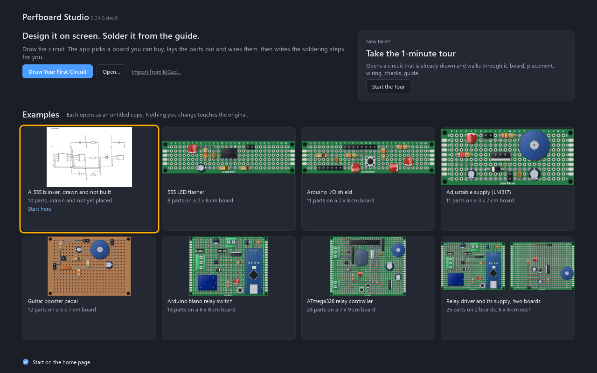
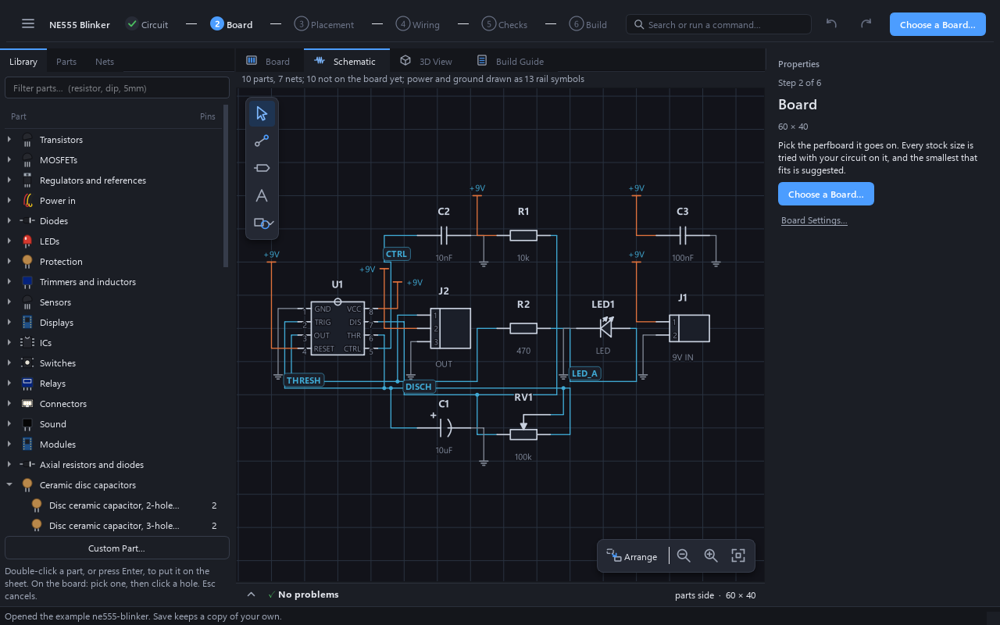
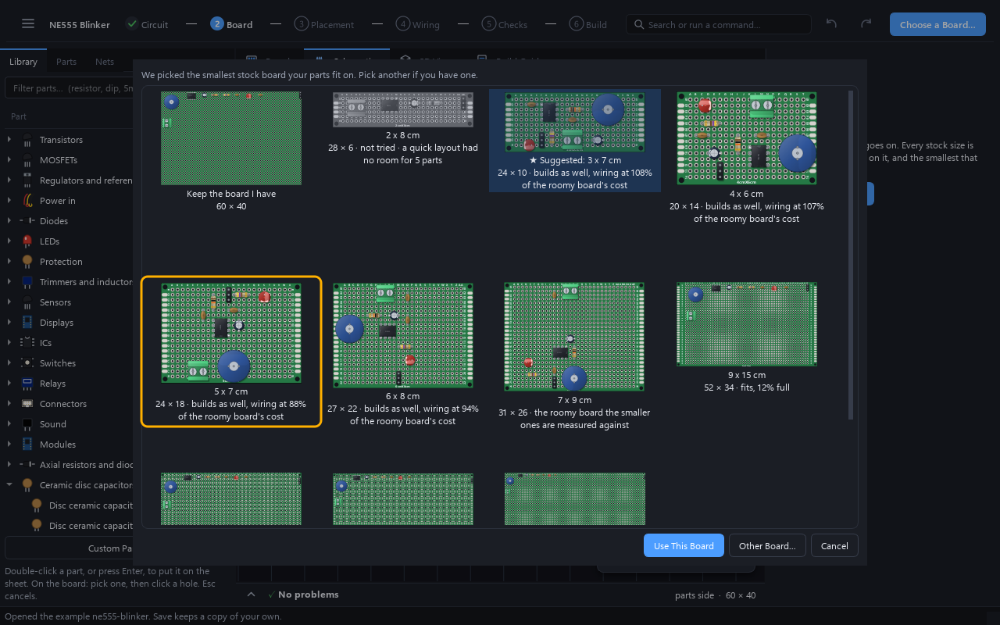
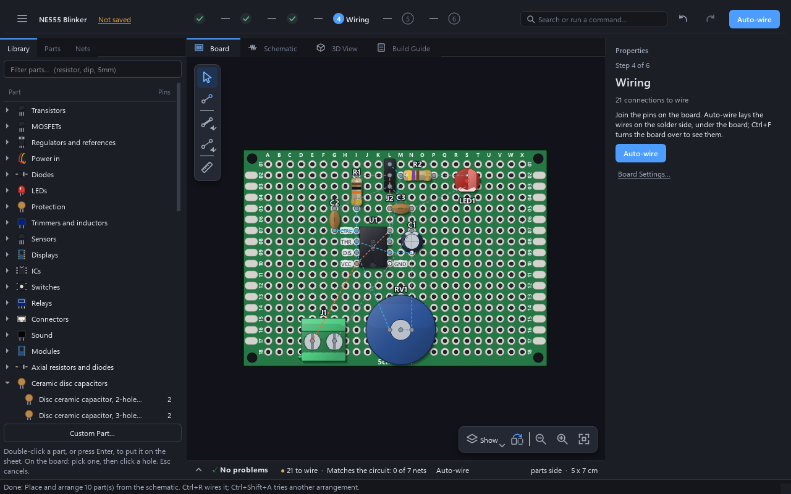
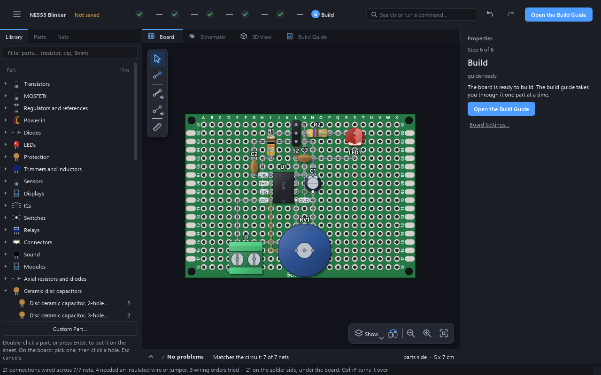
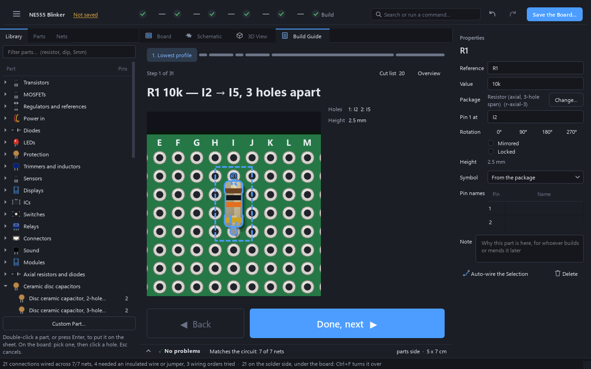
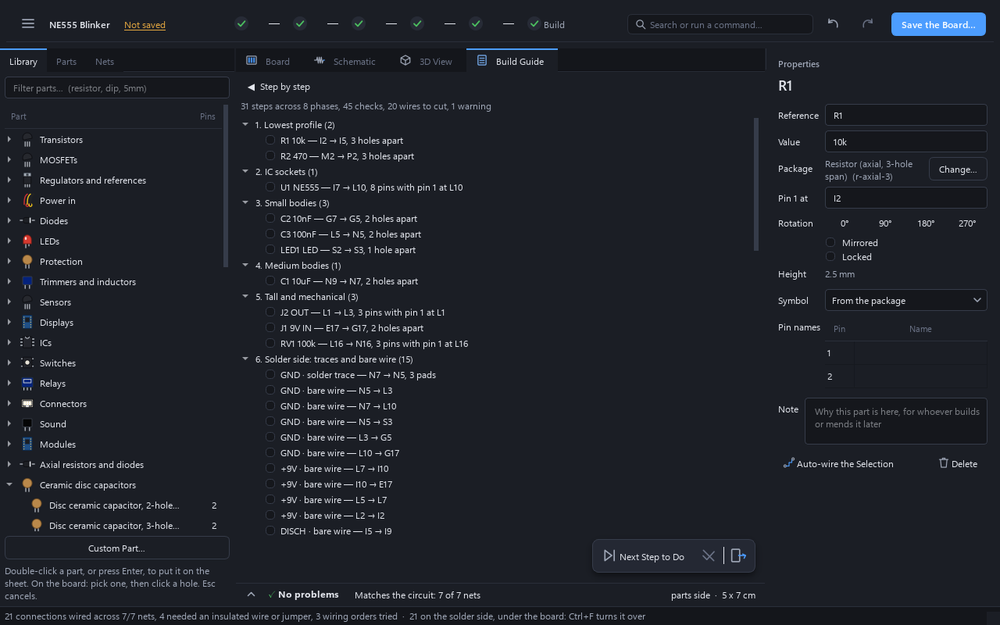
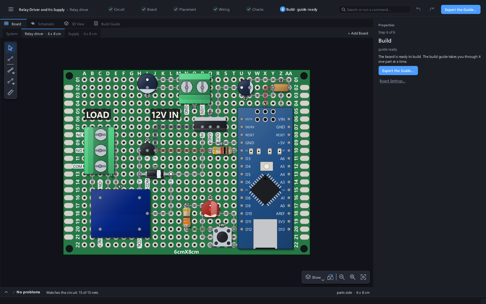
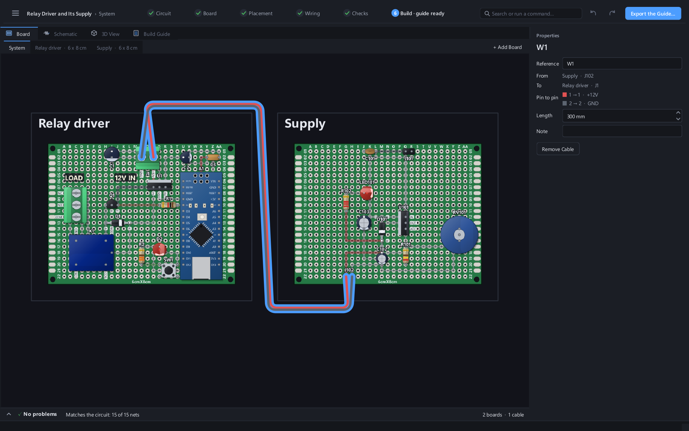
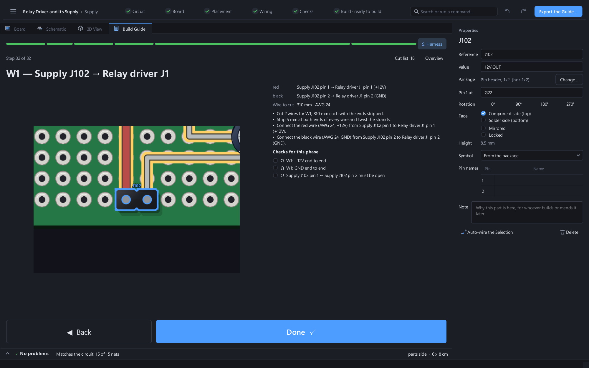

# Your first board, from Home to the build guide

About ten minutes, and no soldering yet: this takes the 555 LED blinker from a drawn
circuit to a board you can build, in the window and in the order the window offers it.
The soldering takes longer, and the guide at the end is what it is for.

You need Perfboard Studio ([installers or `pip install perfboard-studio`](../README.md#running-it))
and nothing else. The circuit is one of the examples that ship with it.

## What you will build

A 555 timer in astable mode flashing an LED, the flash rate set by a pot.

| | | |
|---|---|---|
| U1 | NE555, DIP-8 | the timer |
| R1 | 10k | charges the timing capacitor |
| RV1 | 100k pot | the flash rate, wired as a rheostat |
| C1 | 10 µF electrolytic | the timing capacitor |
| C2 | 10 nF | on the control pin |
| C3 | 100 nF | decouples the supply |
| R2 | 470 Ω | limits the LED's current |
| LED1 | 5 mm LED | |
| J1 | 2-pin screw terminal | 9 V in |
| J2 | 3-pin header | OUT, +9 V, GND |

For the bench: a perfboard of about 5 × 7 cm (this page picks that size, and the window will
offer others), a soldering iron and solder, wire cutters and a multimeter. The guide's
continuity and resistance checks are for the multimeter.

## 1. Start from Home

On a first start Home is the whole window. Click the first example card, "A 555 blinker,
drawn and not built". It opens as an untitled copy, so nothing you do touches the original.
(The tour card beside it walks through the same circuit one sentence at a time.)

## 2. A circuit with no board yet

What opens is the circuit: ten parts and seven nets, drawn on the schematic, and none of it
on a board. The step bar along the top says where you stand (Circuit is done, Board is next),
and the button at its right end is the next thing to do. Properties, with nothing selected,
is a card for the same step: where the work stands, what to do now and a button for it. You
press that button for every step below.

## 3. Choose the board

**Choose a Board…** does not ask you to guess: "We picked the smallest stock board your parts
fit on. Pick another if you have one." It places and wires the circuit on a roomy board, then
on each smaller stock size, and shows each result with its size in holes and what the wiring
cost against the roomy one; the suggested board is starred. Pick one (this page picks
5 × 7 cm) and press **Use This Board**.

## 4. Place the parts

**Place on the Board** puts every part on the board: the connectors at the edge where a cable
reaches them, the pot where a finger can turn it. One Ctrl+Z takes the whole placement
back, and **Rearrange** (Ctrl+Shift+A) tries another arrangement.

## 5. Wire it

**Auto-wire** lays every connection. A connection on perfboard is not one thing: it can be
a solder trace, a bare wire, an insulated wire or a jumper over the parts, and the router
prices them differently. On this board it wired 21 connections across all seven nets. Four
of them needed an insulated wire or a jumper, which the summary line at the bottom of the
window says.

The Problems drawer under the board has the verdict: no problems, and "Matches the circuit:
7 of 7 nets", which is the board's real connectivity extracted and compared with the
circuit you drew.

## 6. Open the build guide

**Open the Build Guide** shows the first step large: the board zoomed onto the step's holes,
the part that goes in, and which holes it goes in. **Done, next** ticks it and moves to the
next one.

**Overview** is the same guide as a list. On this board it is 31 steps across 8 phases,
with 45 checks and 20 wires to cut. The numbers change with the board you chose.

The order is the order you solder in, which is not the order of the schematic:

- **Parts go in lowest first**, so the board lies flat on the bench while you work: the
  resistors, then the chip's socket, then the small bodies, the electrolytic, and last the
  tall and mechanical parts.
- **Then the board is turned over** and the copper goes on: the solder traces, then the wires.
- **Checks sit between the phases** and say what to measure: "U1 pin 4 to C3(−) must show
  continuity" is the kind of check, and before power-on one says the supply must not read as a
  short to GND. They are derived from the circuit, so they name the holes of your board.

Where a part has a polarity or a pin 1, the step says which way round, and says to check it
against the part's datasheet.

## 7. Save it and take it to the bench

**Save the Board…** (Ctrl+S) keeps the board as a plain `.perf` file. **Save Project**
(Ctrl+Alt+S) also writes everything generated from it into an `outputs/` folder beside it:
the 1:1 print of the board, the schematic as SVG, PDF and PNG, the guide, the bill of
materials and the cut list.

## Several boards and a cable

Some projects are not one board: a controller and its supply, a sensor head on a cable. A
system is still one file and one circuit, drawn once. This section uses the finished example
`examples/relay-and-supply.perf`, a relay driver and its supply on two boards with a cable
between them.

### Add a board

**Board ▸ Add Board**, or **+ Add Board** at the right of the strip above the board, adds a
board the size of the one in front and puts it in front. It is named by its place ("Board 2")
until you name it: with nothing selected, Name in Properties is that board's own. **Design the
Board…** and **Change…** work on the board in front, so each board can be a different size or
kind.

The strip appears when there is a second board. Click a name to put that board in front; the
Board panel, Properties, the wiring and the checks then speak about that board. A new board is
empty, and says so, and says how a part gets there: drop a part's symbol from the schematic
onto the board in front, or right-click a part already on another board and choose **Move to
Board**. A part moved this way takes its copper with it, in one undo step.

### Join two boards with a cable

**Board ▸ Add Cable…** asks which connector on each board, a reference for the cable (W1) and,
if you know it, its length. It pairs the wires by net: a pin of each connector on the same
net becomes a wire, in the colour that net's wires are cut in everywhere else. What it cannot
pair, a net that has no counterpart on the other connector, is left out and said, never
guessed, because a guessed wire is a crossed cable nobody chose.

### Read the System view

**System**, the strip's first entry, draws the boards side by side with the cables between
them. Click a board to see its name, size and **Open** (a double-click opens it too) and
**Remove Board**; click a cable to see its reference, its two ends, each wire pin to pin in
its colour, its length and note, and **Remove Cable**. The 3D tab, with System in front,
shows every board and the cables between them hung at their length, which is what the build
will look like. A cable given a length shorter than the distance between its ends is said in
the status line, not refused: where the boards sit on the bench is not something the file knows.

The checks read across all the boards. **Matches the circuit** compares the whole system with
the circuit, joining each board's copper through the cables, so a net that is open between the
boards is reported with the boards it is split across, and a cable wired pin 1 to pin 2 shows
as itself, drawn in red on System, with its swapped wires named by their colours.

### The harness in the guide

Each board's guide measures only its own pins, and ends with the same last phase, **Harness**,
because a cable is fitted to connectors that are already soldered. It has a step for every
cable: the wires to cut (a little longer than the cable's length: 310 mm for W1's 300 mm, or "cut to
fit" if no length was given), each wire's
colour and gauge, how much to strip at both ends, which connector and pin each end goes to,
and the checks: each wire end to end, and neighbouring wires on different nets kept apart. They
are the last thing before the system sees power. The exported guide has the same section and
the cut list a row for each cable wire.

## Where to go next

- The other examples, finished boards you can open and change, are described in
  [examples/README.md](../examples/README.md).
- To drive the same steps from an agent, see [docs/MCP.md](MCP.md).

This is pre-alpha software, and nobody has yet reported building a board from a generated
guide. Check every measurement against the part in your hand, and if something in the guide
is wrong, [an issue](https://github.com/medinstech/perfboard-studio/issues) is the most useful
thing you can send.
